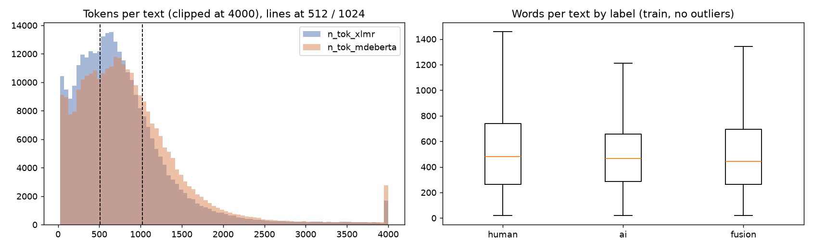
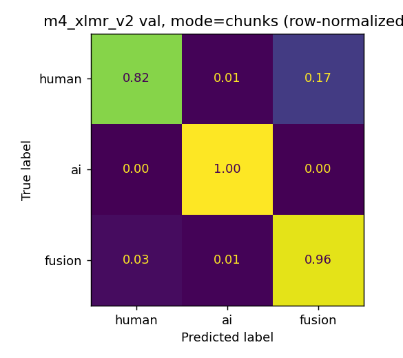
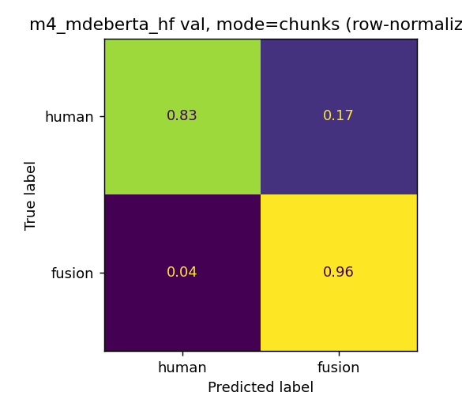

# AI-generated text detection: human / ai / fusion — HW3, UCU AI 2026

**Author:** Bohdan Kolodchak · **Kaggle:** bohdankolodchak
**Selected final submissions:** `sub_4.csv` (public 0.94585 / private 0.94834) and `sub_1.csv` (public 0.94207 / private 0.94388)
**Code:** [`code/`](code/) · run instructions: [`code/README.md`](code/README.md) · demo: [`code/notebooks/demo_pipeline.ipynb`](code/notebooks/demo_pipeline.ipynb) 

> Sections 1–7: 1–2 pages of text (≈ 900–1000 words). Tables and figures are in the Appendix.
> The text of this report is written by the author; AI tools were used only for writing code.

## 1. Task and setup  *(≈ 80 words)*
<!-- WRITE: what is predicted (text + lang + domain -> human / ai / fusion); why macro-F1 makes fusion important;
data size; how compute was organised (Kaggle CPU/T4 kernels cloning the repo, local mini sample for tests).
FACTS: train 272,352 / test 25,000; en 80.6 % / de 19.4 %; 8 domains; ai 44.8 %, fusion 30.7 %, human 24.5 %;
"always ai" gives macro-F1 0.205. -->

## 2. EDA and what it changed  *(≈ 200 words)*
<!-- WRITE 4–5 findings, each as "observation -> decision". FACTS:
- Tokens: XLM-R median 665, 63.8 % > 512 (arxiv/gutenberg 93 %, blogs 16 %) -> long-text handling needed (Fig. A2).
- Style inside every domain: ai has longer words (8/8 domains), higher TTR (8/8), almost no digits (8/8);
  commas only 6/8; fusion in between -> real authorship signal, not a domain artefact (Fig. A3).
- Domain shift: gutenberg 2.7 % train vs 7.4 % test; gutenberg 91.5 % ai, arxiv 84.3 % ai -> per-domain F1 (Fig. A1).
- Texts have no line breaks; human texts keep typos, lowercase starts, corpus artefacts ("By . Name .") and fusion
  keeps them too -> char n-grams without lowercasing.
- What makes fusion different: best-neighbour word 3-gram Jaccard human<->fusion ≈ 0.55 (~70 % of trigrams kept),
  ai ≈ 0.02 (written from scratch); 4 % of fusion texts are almost unchanged (Jaccard >= 0.95) (Fig. A4). -->

## 3. Validation protocol  *(≈ 120 words)*
<!-- WRITE: why a random split is wrong here and how groups were built; the fixed split; how ensemble
parameters were tuned honestly. FACTS: groups = connected components of pairs with Jaccard > 0.2 (valley in Fig. A4);
StratifiedGroupKFold (label|lang|domain), 5 folds; fixed 50k train / 10k val from fold 0; 0 groups shared;
random split: 46.7 % of val texts (fusion 91.3 %, human 75.7 %) would have a relative in train;
best Jaccard > 0.2: train 47.3 % vs test->train 0.6 % (organisers' claim verified);
ensemble weights: tuned on one grouped half of val, scored on the other ("honest");
noticed (and did not use) that near-duplicate pairs inside test reveal "not ai". -->

## 4. Baseline: TF-IDF + linear models  *(≈ 130 words)*
<!-- WRITE: features and why; small grid; ablation; per-class result; surprise of the random-split control.
FACTS: word 1–2 + char 3–5 n-grams, no lowercasing, sublinear tf, fitted on train only;
grid LinearSVC C 0.1/0.5 -> 0.860/0.870, LogReg C 3/10 -> 0.881/0.882; ablation char 0.881, word 0.861;
best val 0.8816 (human 0.826, ai 0.985, fusion 0.834), public LB 0.876; errors almost only human<->fusion (Fig. A5);
random split gave LOWER val (0.869): near-identical human/fusion pairs with different labels confuse the model. -->

## 5. Encoder: XLM-R base  *(≈ 150 words)*
<!-- WRITE: why XLM-R; training setup; the three long-text strategies and what they show; comparison with baseline.
FACTS: XLM-R base, 50k texts, 2 epochs, lr 2e-5, batch 16, fp16, 56 min T4, trained on the first 510 tokens;
val: head 0.8672, head+tail 0.8831, chunks (≤ 8 × 510 tokens, mean logits) 0.8975 (+0.030, fusion +0.053);
epoch curve 0.816 -> 0.867 (still rising); vs TF-IDF: worse with head only, better with chunks;
errors in the opposite direction to TF-IDF (human->fusion 506 vs fusion->human 529); arxiv 0.655 vs TF-IDF 0.851;
public LB 0.890. -->

## 6. Own experiments (including failed ones)  *(≈ 250 words)*
<!-- WRITE one short paragraph or table row per experiment: idea (from which diagnosis) -> result -> why.
Reference values are in the table; keep the "failed" ones. -->

| # | Experiment (reference) | Val macro-F1 (honest) | Result |
|---|---|---|---|
| E1 | Ensemble TF-IDF + XLM-R (XLM-R 0.8975) | 0.9180 | ✅ +0.021; weight ≈ 0.5 in both halves; errors become symmetric |
| E2 | Class weights on XLM-R (0.8975) | 0.9121 | ✅ +0.015 alone, but… |
| E1+E2 | Class weights on top of the ensemble (0.9180) | 0.9176 | ❌ no gain: the ensemble already cancels the bias |
| E3 | TF-IDF on 150k instead of 50k (0.8816) | 0.9019 | ✅ +0.020, more data |
| E4 | XLM-R v2: 100k, 3 epochs, random chunk per epoch (0.8975) | 0.9274 | ✅ +0.030 (three changes together) |
| E5 | mDeBERTa-v3 specialist human vs fusion, hierarchical (0.9456) | 0.9477 | ≈ +0.002, noise level |
| E6 | Adding the weaker XLM-R m3 to the blend (0.9456) | 0.9453 | ❌ same architecture adds nothing |
<!-- Also mention technical problems solved: mDeBERTa fp16 checkpoint vs AMP (cast to fp32), OOM at batch 16 (batch 8). -->

## 7. Final model  *(≈ 100 words)*
<!-- WRITE: what the final model is and why these two submissions were selected; val vs LB.
FACTS: sub_4 = 0.5 TF-IDF(150k) + 0.1 XLM-R m3 + 0.4 XLM-R v2, then P(ai) kept and the human/fusion split mixed
with mDeBERTa (a = 0.2); val 0.9477 / public 0.94585 / private 0.94834.
sub_1 = 0.5 TF-IDF + 0.5 XLM-R v2 (no tuned weights, most robust); val 0.9456 / private 0.94388.
Validation tracked the leaderboard within 0.001–0.007 at every step (table A1). -->

## How to reproduce
See [`code/README.md`](code/README.md): setup, unit tests, demo notebook (mini sample, CPU), and the full pipeline
(Kaggle kernels `code/notebooks/00`–`07`, then `scripts/ensemble_final.py`). Seed 42; fixed split in `code/splits/`.

## References
<!-- XLM-R (Conneau et al., 2020); DeBERTa-v3 (He et al., 2021); GhostWriter dataset (Schaaf, Bönisch, Mehler, LREC 2026);
scikit-learn, Hugging Face Transformers, PyTorch. -->

---

## Appendix

**Table A1. Validation vs leaderboard**

| Submission | Val macro-F1 | Public LB | Private LB |
|---|---|---|---|
| m2 TF-IDF 50k | 0.8816 | 0.87608 | 0.86929 |
| m3 XLM-R chunks | 0.8975 | 0.89004 | 0.89723 |
| E1 TF-IDF 50k + XLM-R | 0.9180 | 0.91661 | 0.91546 |
| E1 TF-IDF 150k + XLM-R | 0.9267 | 0.92636 | 0.92185 |
| **sub_1** TF-IDF 150k + XLM-R v2 | 0.9456 | 0.94207 | 0.94388 |
| **sub_4** final ensemble + specialist | **0.9477** | **0.94585** | **0.94834** |

**Table A2. Per-domain macro-F1 (val)**

| Domain | TF-IDF 150k | XLM-R v2 | Final ensemble |
|---|---|---|---|
| arxiv_papers | 0.886 | 0.672 | 0.672 |
| blog_authorship_corpus | 0.786 | 0.874 | 0.879 |
| bundestag | 0.921 | 0.916 | 0.947 |
| cnn_news | 0.951 | 0.987 | 0.992 |
| euro_court_cases | 0.934 | 0.847 | 0.934 |
| gutenberg | 0.740 | 0.854 | 0.885 |
| house_of_commons | 0.908 | 0.954 | 0.965 |
| student_essays | 0.903 | 0.951 | 0.965 |

**Fig. A1. Class balance per domain and domain shift train vs test**

**Fig. A2. Text length in tokens (lines at 512 / 1024) and words per class**

**Fig. A3. Style features inside each domain**

**Fig. A4. Best-neighbour word 3-gram Jaccard (groups threshold 0.2)**

**Fig. A5. Confusion matrices (val, row-normalised): TF-IDF 50k, XLM-R m3, XLM-R v2, mDeBERTa specialist**

| | |
|---|---|
|  |  |
|  |  |
