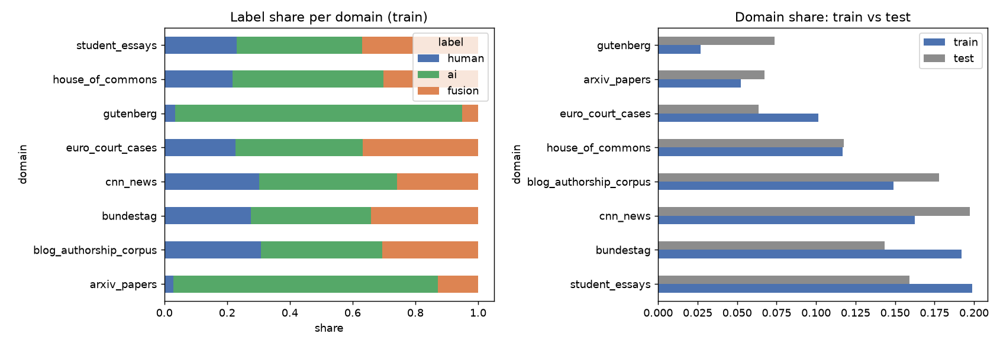
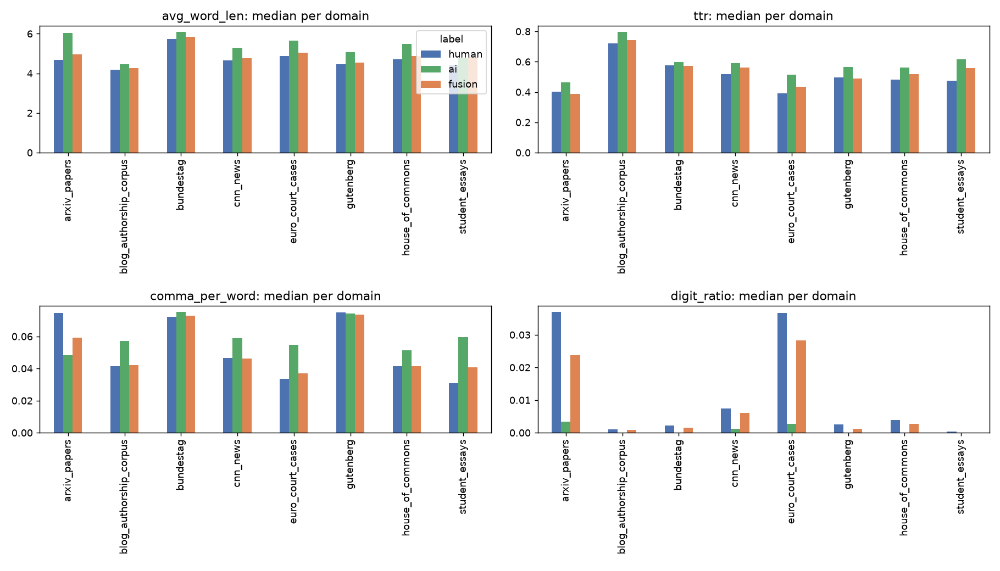
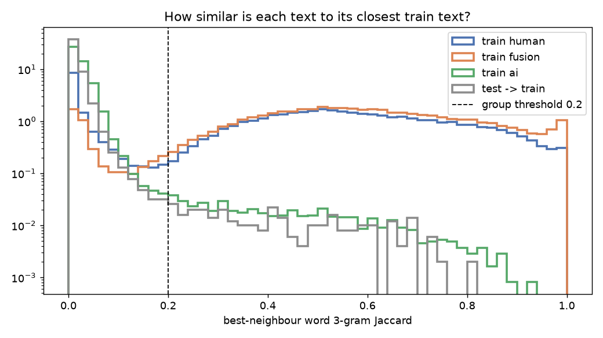
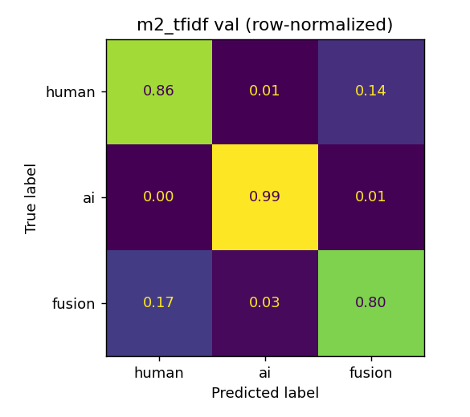
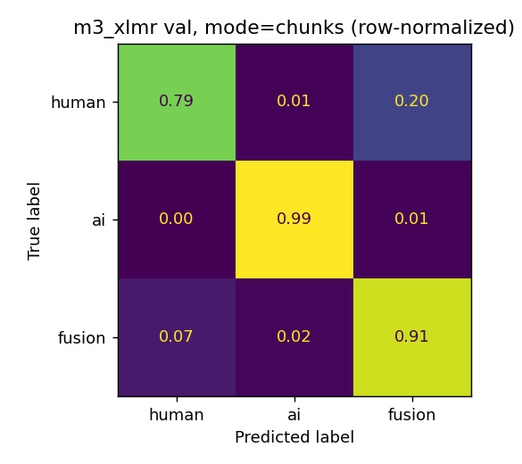

# AI-generated text detection: human / ai / fusion — HW3, UCU AI 2026

**Author:** Bohdan Kolodchak · **Kaggle:** bohdankolodchak
**GitHub:** https://github.com/BodiyaKol/ucu-ai-hw3-ai-text-detection_Kolodchak
**Selected final submissions:** `sub_4.csv` (public 0.94585 / private 0.94834) and `sub_1.csv` (public 0.94207 / private 0.94388)
**Code:** [`code/`](code/) · run instructions: [`code/README.md`](code/README.md) · demo: [`code/notebooks/demo_pipeline.ipynb`](code/notebooks/demo_pipeline.ipynb) 

## 1. Task and setup 
<!-- WRITE: what is predicted (text + lang + domain -> human / ai / fusion); why macro-F1 makes fusion important;
data size; how compute was organised (Kaggle CPU/T4 kernels cloning the repo, local mini sample for tests).
FACTS: train 272,352 / test 25,000; en 80.6 % / de 19.4 %; 8 domains; ai 44.8 %, fusion 30.7 %, human 24.5 %;
"always ai" gives macro-F1 0.205. -->
Загалом в нас є датасет із купи текстів, відповідно певні тексти написані, або аішкою, або людиною, або змішаними зусиллями. Наша задача натренувати модельки, щоб предіктили, який із цих текстів був відповідно написаний аішкою, чи людиною, чи фюжин. Тож виводом будуть імовірності цього конкретного тексту бути належним до одного із 3 видів.

Тож в нас є train 272 352 тексти, 25 000 test текстів. ми маємо також 8 domain до яких належать тексти. Та загалом по лейблах 44.8% є аішка, 30.7% fusion, 24.5% написані людиною.

Метрика якій ми довіряємо це macro-F1: для кожного класу рахуємо F1 (гармонічне середнє precision та recall), а потім беремо середнє по трьох класах.
## 2. EDA and what it changed 
<!-- WRITE 4–5 findings, each as "observation -> decision". FACTS:
- Tokens: XLM-R median 665, 63.8 % > 512 (arxiv/gutenberg 93 %, blogs 16 %) -> long-text handling needed (Fig. A2).
- Style inside every domain: ai has longer words (8/8 domains), higher TTR (8/8), almost no digits (8/8);
  commas only 6/8; fusion in between -> real authorship signal, not a domain artefact (Fig. A3).
- Domain shift: gutenberg 2.7 % train vs 7.4 % test; gutenberg 91.5 % ai, arxiv 84.3 % ai -> per-domain F1 (Fig. A1).
- Texts have no line breaks; human texts keep typos, lowercase starts, corpus artefacts ("By . Name .") and fusion
  keeps them too -> char n-grams without lowercasing.
- What makes fusion different: best-neighbour word 3-gram Jaccard human<->fusion ≈ 0.55 (~70 % of trigrams kept),
  ai ≈ 0.02 (written from scratch); 4 % of fusion texts are almost unchanged (Jaccard >= 0.95) (Fig. A4). -->

Загалом далі ми мали фактично зрозуміти специфіку датасету, щоб думати як препроцесити дані, а також які аргументи модельок будуть впливати на результат найбільше.

- **Домени (Fig. A1).** 
Загалом подивимось на домени і побачимо, що всі домени крім gutenberg та arxiv розподілені відносно рівномірно між групами, що ми оцінюємо. А натомість в них дуже багато AI, тож валідно буде розглядати ті домени якось окремо, і думати над статистиками f1 теж по кожному домену. А ще gutenberg у test більше (7.4% проти 2.7% у train), тому спліт стратифікуємо і за доменом.
- **Довжина (Fig. A2).**
Загалом якщо прикинути ніби ми закинули текст в модель, то першим кроком буде поділ на токени (слова або їх шматки), а зазвичай моделька наприклад XLM-R приймає 512 токенів, тому є сенс розглядати інфу чанками по 510 токенів, щоб не втратити решту тексту. Чому це вартує, бо в нас медіана 665 токенів XLM-R, і 64% текстів довші за 512.
- **Стиль (Fig. A3).** 
Дуже цікаво подивитись саме на стилістичні ознаки текстів по групах ai|fusion|human. І першим є, що у всіх 8 доменах аішка має довші слова, та TTR(різноманітніший словник) і менше цифр, а також ком аі текст має більше в 6 з 8 доменів. Fusion часто є між human і аішкою по довжині слів(7 з 8 доменів), за TTR(у 5 з 8). Відповідно можна ті тексти прив'язувати до цих властивостей, а не лише за доменом.
- **Сирий текст.**
Загалом переносів немає, а також у human є частинка одруківок, малих літер на початку й слідів корпусу(`By . Name .`), fusion ці помилки зберігає. Тож не варто чистити текст а також зводити до малих літер, а натомість беремо n-грами по символах.
- **Fusion (Fig. A4).** 
І останнім цікавим було зрозуміти спорідненість fusion і human, бо ми побачили, що вони однакові помилки робили. І для оцінки спорідненості я використав Jaccard, чим ближче до 1 тим спорідненіше. Що побачив: аішка має малий цей параметр, тобто переписана з нуля, проте для fusion і human медіана з найближчим сусідом десь 0.55, а 4 % fusion взагалі майже не змінені (від 0.95), тобто fusion це здебільшого переписаний human. Тобто важливо, щоб споріднені тексти не попали по різні частини спліта, а то val буде нечесною перевіркою, тож якщо для текстів Jaccard > 0.2 то ми їх в одну частину спліта. А також важливо розуміти, що розібрати human|fusion буде складно, є сенс пробувати модельки вчити тільки на них як спеціалісти.

## 3. Validation protocol 
<!-- WRITE: why a random split is wrong here and how groups were built; the fixed split; how ensemble
parameters were tuned honestly. FACTS: groups = connected components of pairs with Jaccard > 0.2 (valley in Fig. A4);
StratifiedGroupKFold (label|lang|domain), 5 folds; fixed 50k train / 10k val from fold 0; 0 groups shared;
random split: 46.7 % of val texts (fusion 91.3 %, human 75.7 %) would have a relative in train;
best Jaccard > 0.2: train 47.3 % vs test->train 0.6 % (organisers' claim verified);
ensemble weights: tuned on one grouped half of val, scored on the other ("honest");
noticed (and did not use) that near-duplicate pairs inside test reveal "not ai". -->

Оскільки в на Fusion|Human споріднені,то в нас проблема потрапляння однакових текстів і в val і в train, тому викоритстав методики, що можуть вирішити проблему
- **Групи.** Коли бачимо споріднені тексти, то ми їх з'єднуємо в групу, і просто групи не ділитимемо.
- **Спліт.** 
Логікою спліту, є просто взяти 5 фолдів за допомогою k-Fold і в кожному щоб було досить рівномірно дані розподілені(домени, мови, класи, групи не в одних фолдах), і візьмемо просто 0 фолд як val, а для тренування із тих фолдів інших. На практиці брали 10к текстів для val з 0 фолда і 50к текстів для тренування(потім на екпериментах збільшували).
- **Ваги ансамблю.** 
В ансамблях якось треба ваги визначити, і ми ї визначаємо за допомогбю того, що val ділимо на дві половинки, на одній ми підираємо, а на іншій ми оцінємо, а потім поміняємо місцями, а потім зводимо всі величини і рахуємо f1-macro. І саме такі результати є honest, що я і позначаю далі.

- **Що не використали.** 
І тут буда фіча, що якщо два тексти супер споріднені, то їх можна вважати точно не аі. Але вирішив не користуватись цією фічою, бо ми хочем сам текст розрізняти і його властивості а не оцінку міжтекстову.

## 4. Baseline: TF-IDF + linear models 
<!-- WRITE: features and why; small grid; ablation; per-class result; surprise of the random-split control.
FACTS: word 1–2 + char 3–5 n-grams, no lowercasing, sublinear tf, fitted on train only;
grid LinearSVC C 0.1/0.5 -> 0.860/0.870, LogReg C 3/10 -> 0.881/0.882; ablation char 0.881, word 0.861;
best val 0.8816 (human 0.826, ai 0.985, fusion 0.834), public LB 0.876; errors almost only human<->fusion (Fig. A5);
random split gave LOWER val (0.869): near-identical human/fusion pairs with different labels confuse the model. -->

Суть TF-IDF в тому, що ми ділимо тексти на n-грами і рахуємо, як часто кожна є в тексті (TF), а ті, що є майже в усіх текстах, приглушуємо ваговими коефами (IDF). Словник і коефи беремо лише з train. Взяли слова 1–2, бо це лексика і фрази, та символи 3–5, бо вони ловлять одруківки, цифри, пунктуацію і регістр, тому до малих літер не зводимо.

Лінійна модель дає кожній n-грамі вагу для кожного класу, сумує, і LogReg переводить суму в імовірності. Перебрали LogReg і LinearSVC з різними C, тобто силою регуляризації (табл. A3). Найкраща LogReg з C = 10: val 0.8816, public LB 0.876. Майже все дають символи, слова додають лише 0.0006. Помилки переважно між human і fusion (Fig. A5). На випадковому спліті val навіть нижчий (0.869): імовірно, модельку плутають майже однакові пари human/fusion з різними лейблами.

## 5. Encoder: XLM-R base 
<!-- WRITE: why XLM-R; training setup; the three long-text strategies and what they show; comparison with baseline.
FACTS: XLM-R base, 50k texts, 2 epochs, lr 2e-5, batch 16, fp16, 56 min T4, trained on the first 510 tokens;
val: head 0.8672, head+tail 0.8831, chunks (≤ 8 × 510 tokens, mean logits) 0.8975 (+0.030, fusion +0.053);
epoch curve 0.816 -> 0.867 (still rising); vs TF-IDF: worse with head only, better with chunks;
errors in the opposite direction to TF-IDF (human->fusion 506 vs fusion->human 529); arxiv 0.655 vs TF-IDF 0.851;
public LB 0.890. -->

XLM-R це трансформер, який заздалегідь навчили на текстах 100 мов вгадувати закриті токени, тож англійську й німецьку він вже знає. Через attention кожен токен враховує інші, тобто на відміну від TF-IDF модель бачить порядок слів і контекст.

Ми поставили зверху класифікатор на 3 класи і довчили всю модель: 50k текстів, 2 епохи, lr 2e-5, batch 16, fp16, 56 хв на T4, лише на перших 510 токенах. Довгі тексти перевірили трьома способами: head 0.8672, head+tail 0.8831, chunks (до 8 шматків по 510, логіти усереднюємо) 0.8975, public LB 0.890 (табл. A4). Тобто чим більше тексту бачить модель, тим краще, і найбільше виграє fusion (+0.053), мабуть, бо змінені місця можуть бути не на початку. Val після другої епохи ще ріс, тож є сенс вчити довше.

Помилки в моделей різні: XLM-R частіше називає human фюжином (506), а TF-IDF називає fusion людиною (529). В arxiv XLM-R слабший (0.655 проти 0.851), а в gutenberg кращий (0.868 проти 0.740). Тому є сенс об'єднати їх в ансамбль.

## 6. Own experiments
<!-- WRITE one short paragraph or table row per experiment: idea (from which diagnosis) -> result -> why.
Reference values are in the table; keep the "failed" ones. -->

Кожен експеримент виріс із того, що ми побачили в помилках попередніх модельок, усі на тому самому val (табл. A5).

E1. Ансамбль. Моделі помиляються по-різному, тож усереднили ймовірності: 0.8975 -> 0.9180.
E2. Ваги класів. Сама XLM-R виросла до 0.9121, але поверх ансамблю ваги нічого не дали (0.9176), бо ансамбль вже прибрав цю відмінність помилок.
E3, E4. Більше даних. TF-IDF на 150k: 0.9019. XLM-R v2 (100k, 3 епохи, випадковий чанк): 0.9274. Разом 0.9456.
E5. Спеціаліст mDeBERTa лише на human/fusion: +0.001-0.002, тобто на рівні шуму. По дорозі ваги з fp16 перевели у fp32 для AMP, а batch зменшили до 8 через пам'ять GPU.
E6. Стара XLM-R у суміші нового не дає (0.9453).

Головне: найбільше дали різні модельки разом і більше даних, а тонке налаштування поверх ансамблю майже нічого.

## 7. Final model

Фінальна модель (`sub_4`) працює у два кроки:
1. **Суміш:** 0.5 · TF-IDF (150k) + 0.1 · XLM-R m3 + 0.4 · XLM-R v2.
2. **Спеціаліст:** P(ai) лишаємо із суміші, а решту ймовірності ділимо між human і fusion: 0.2 від mDeBERTa і 0.8 від самої суміші.

Чому саме вона. У неї найкращий val (0.9477), public (0.94585) і private (0.94834) серед наших сабмітів (табл. A1). Суміш дає +0.020 до найкращої окремої моделі, а val відрізняється від private менш ніж на 0.001, тож протокол із групами себе виправдав.

Другий сабміт sub_1 (0.5 TF-IDF + 0.5 XLM-R v2) простіший. Його взяли для підстраховки, бо перевага sub_4 мала (+0.002 на val), але на private вона збереглась (+0.0045).

Що лишилось слабким: в arxiv ансамбль має лише 0.672, а один TF-IDF 0.886 (табл. A2). Наступним кроком були б різні ваги для різних доменів.

## How to reproduce
See [`code/README.md`](code/README.md): setup, unit tests, demo notebook (mini sample, CPU), and the full pipeline
(Kaggle kernels `code/notebooks/00`–`07`, then `scripts/ensemble_final.py`). Seed 42; fixed split in `code/splits/`.

## References
1. XLM-R: Conneau et al., *Unsupervised Cross-lingual Representation Learning at Scale*, ACL 2020 — https://arxiv.org/abs/1911.02116 · model: https://huggingface.co/FacebookAI/xlm-roberta-base
2. mDeBERTa-v3: He et al., *DeBERTaV3*, ICLR 2023 — https://arxiv.org/abs/2111.09543 · model: https://huggingface.co/microsoft/mdeberta-v3-base
3. Competition, data (GhostWriter, CC BY-NC-SA 4.0) and rules: https://www.kaggle.com/competitions/ai-generated-text-detection-hw3-ucu-ai-2026/rules
4. Claude (Anthropic), used via Claude Code to write and debug the code; the report text is written by the author — https://www.anthropic.com/claude

**Use of AI tools.** Code was written with the help of Claude (Anthropic) in Claude Code; no closed LLM was used to label, generate or extract features from the data. The report text with my own thoughts.
---

## Appendix

**Table A1. Validation vs leaderboard**

| Submission | Val macro-F1 | Public LB | Private LB |
|---|---|---|---|
| m2 TF-IDF 50k | 0.8816 | 0.87608 | 0.86929 |
| m3 XLM-R chunks | 0.8975 | 0.89004 | 0.89723 |
| E1 TF-IDF 50k + XLM-R | 0.9180 | 0.91661 | 0.91546 |
| E1 TF-IDF 150k + XLM-R | 0.9267 | 0.92636 | 0.92185 |
| **sub_1** TF-IDF 150k + XLM-R v2 | 0.9456 | 0.94207 | 0.94388 |
| **sub_4** final ensemble + specialist | **0.9477** | **0.94585** | **0.94834** |

**Table A2. Per-domain macro-F1 (val)**

| Domain | TF-IDF 150k | XLM-R v2 | Final ensemble |
|---|---|---|---|
| arxiv_papers | 0.886 | 0.672 | 0.672 |
| blog_authorship_corpus | 0.786 | 0.874 | 0.879 |
| bundestag | 0.921 | 0.916 | 0.947 |
| cnn_news | 0.951 | 0.987 | 0.992 |
| euro_court_cases | 0.934 | 0.847 | 0.934 |
| gutenberg | 0.740 | 0.854 | 0.885 |
| house_of_commons | 0.908 | 0.954 | 0.965 |
| student_essays | 0.903 | 0.951 | 0.964 |

**Table A3. TF-IDF grid and ablation (50k train)**

| Модель (50k train) | Ознаки | C | Val macro-F1 |
|---|---|---|---|
| LinearSVC | word + char | 0.1 | 0.8602 |
| LinearSVC | word + char | 0.5 | 0.8700 |
| LogReg | word + char | 3 | 0.8806 |
| **LogReg** | **word + char** | **10** | **0.8816** |
| LogReg | тільки char | 10 | 0.8810 |
| LogReg | тільки word | 10 | 0.8605 |

**Table A4. Baseline vs XLM-R and long-text strategies (50k train)**

| Модель (50k train) | Val macro-F1 | F1 human | F1 ai | F1 fusion |
|---|---|---|---|---|
| TF-IDF + LogReg | 0.8816 | 0.826 | 0.985 | 0.834 |
| XLM-R head | 0.8672 | 0.796 | 0.988 | 0.818 |
| XLM-R head+tail | 0.8831 | 0.820 | 0.987 | 0.842 |
| **XLM-R chunks** | **0.8975** | **0.837** | **0.985** | **0.871** |

**Table A5. Own experiments**

| # | Experiment (reference) | Val macro-F1 (honest) | Result |
|---|---|---|---|
| E1 | Ensemble TF-IDF + XLM-R (XLM-R 0.8975) | 0.9180 | +0.021; weight ≈ 0.5 in both halves; errors become symmetric |
| E2 | Class weights on XLM-R (0.8975) | 0.9121 | +0.015 alone |
| E1+E2 | Class weights on top of the ensemble (0.9180) | 0.9176 | no gain: the ensemble already cancels the bias |
| E3 | TF-IDF on 150k instead of 50k (0.8816) | 0.9019 | +0.020, more data |
| E4 | XLM-R v2: 100k, 3 epochs, random chunk per epoch (0.8975) | 0.9274 | +0.030 (three changes together) |
| E3+E4 | TF-IDF 150k + XLM-R v2, `sub_1` (TF-IDF 150k + XLM-R m3: 0.9267) | 0.9456 | +0.019; weights 0.5/0.5 in both halves |
| E5 | mDeBERTa-v3 specialist on top of E3+E4 (0.9456) | 0.9470 | +0.001, noise level |
| E5+E6 | specialist on top of E6, `sub_4` (E6 0.9453) | 0.9477 | +0.002, noise level |
| E6 | Adding the weaker XLM-R m3 to the blend (0.9456) | 0.9453 | same architecture adds nothing |

**Table A6. Observations and the final model**

| Що побачили | Що є у фінальній моделі |
|---|---|
| Класи різняться стилем: цифри, регістр, одруківки (розділ 2) | TF-IDF на символах без зведення до малих літер |
| 64 % текстів довші за 512 токенів, а chunks кращі за head (розділи 2, 5) | XLM-R v2 вчиться на випадкових чанках і оцінює до 8 чанків тексту |
| TF-IDF і XLM-R помиляються по-різному (розділ 5, E1) | суміш, де TF-IDF і XLM-R мають порівну, по 0.5 |
| Більше даних допомагає (E3, E4) | 150k текстів для TF-IDF, 100k для XLM-R v2 |
| Більшість помилок між human і fusion (розділи 4, 5) | спеціаліст лише на цій парі (E5), з малою вагою, бо приріст малий |
| Ваги класів поверх ансамблю не допомогли (E1+E2) | їх не беремо |

**Fig. A1. Class balance per domain and domain shift train vs test**

**Fig. A2. Text length in tokens (lines at 512 / 1024) and words per class**

**Fig. A3. Style features inside each domain**

**Fig. A4. Best-neighbour word 3-gram Jaccard (groups threshold 0.2)**

**Fig. A5. Confusion matrices (val, row-normalised): TF-IDF 50k, XLM-R m3, XLM-R v2, mDeBERTa specialist**

| | |
|---|---|
|  |  |
|  |  |
